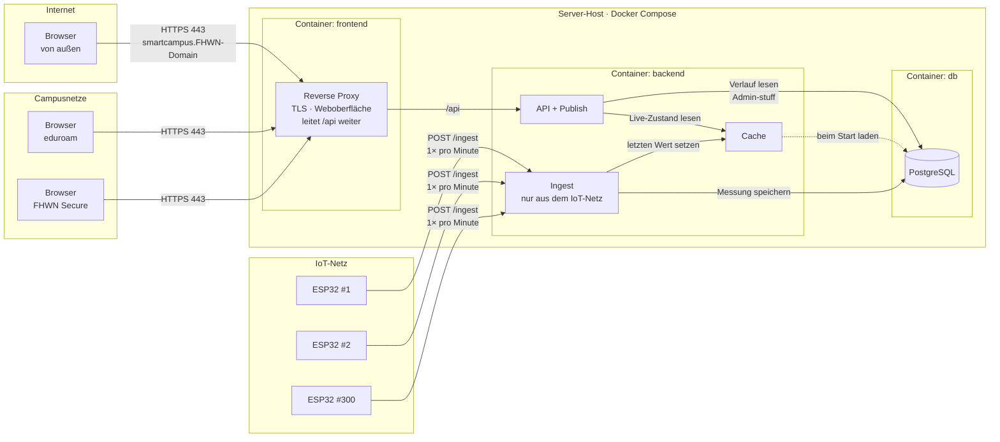
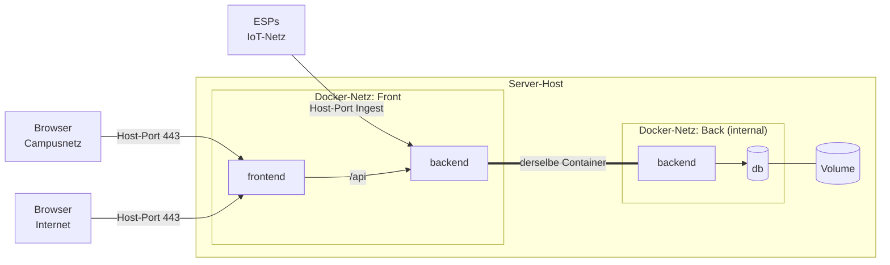
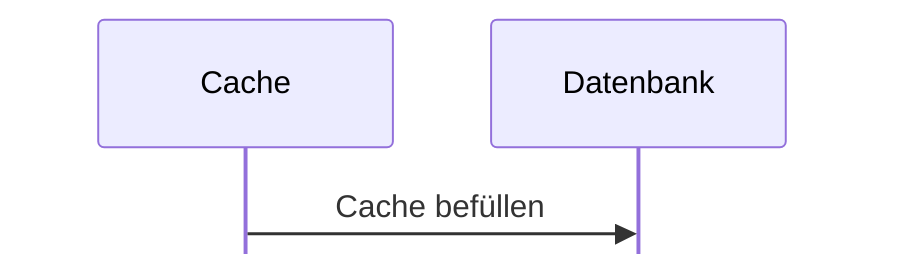
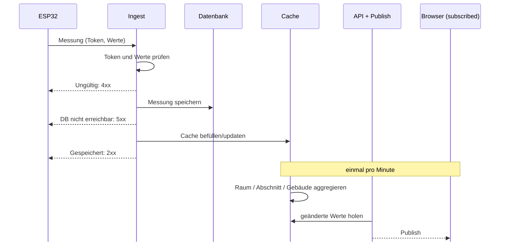
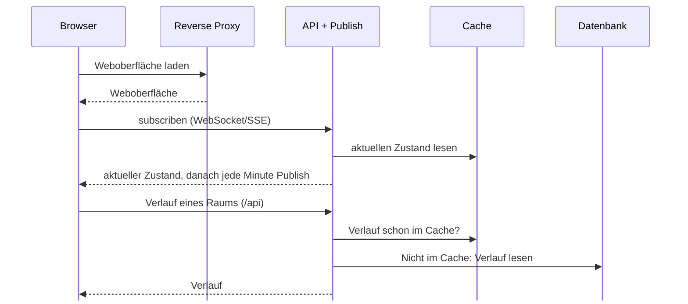
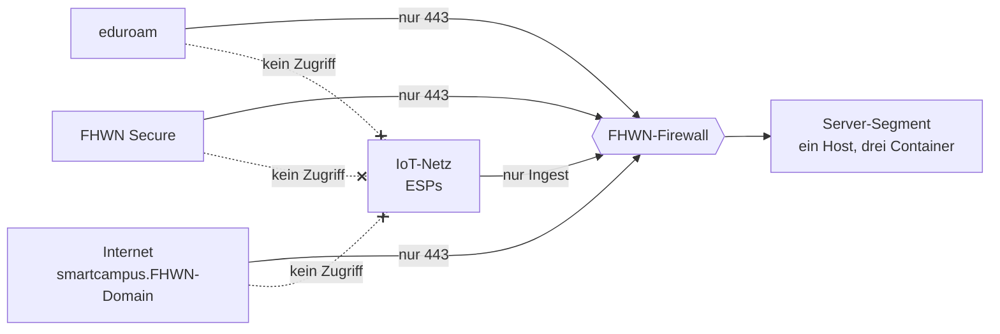
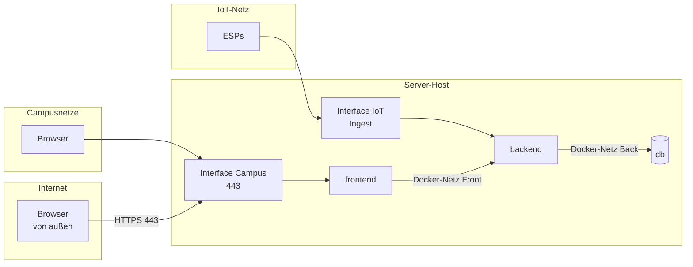

# Smart Campus Architektur

## Überblick

### Grundprinzipien

**Kein direkter zugriff auf die Datenbank** 
Alles läuft über die API. Der DB-Container wird nur vom Backend über das interne Docker-Netz erreicht.
**Äußerliches erreicht nur Frontend**
Von Außen erreicht man nur das Frontend, das das Dashboard und Daten ausliefert. Ingest, Backend und die Datenbank werden von außen nie erreicht.
**Trennung von Ingest und öffentlicher API**
Die Sensoren bekommen ihren eigenen Endpunkt, der nür über das IoT-Netz erreichbar ist, über dem sie die Sensordaten übermitteln und ins System schreiben.
**Pub/Sub**
Browser subscriben und bekommen neue Werte gepusht, statt selbst abzufragen.
**Live-Zustand aus dem Cache**
Schont die Datenbank. Ist nice.

## Komponenten

### Sensoren
Die ESPs mit den Sensoren senden einmal pro Minute ihre Messungen über _einen_ HTTPS-Request. Da werden alle für den ESP32 vorhandenen Werte und selbst berechneten Zuständen/Werten (Raumbelegt, Fenster offen, etc) an den Ingest geschikt. Jedes Gerät hat einen festen Sende-Offset (maybe berechnet durch einen Hash der MAC?) um Lastspikes zu minimieren. 

### Backend-Container
1. **Ingest**
   - Token prüfen
   - Werte validieren
   - Ungültiges direkt mit`4xx` beantworten
   - Gültiges in die DB und den Cache schreiben
   - '2xx' antwort bei Erfolg
   - '5xx' antwort bei nicht Erfolg
2. **Cache und Aggregation**
1x/Minute alles für frontend berechnen, aggregieren und auswerten..
3. **Publish**
Geänderte Werte per WebSocket oder SSE an die Clients pushen
4. **API**
Verlauf und genauere Funktionen, Stammdaten, etc. Admin funktionen.
5. **restliches**
Ältere Daten sichern. Backups. sowas halt. 

### Frontend-Container
- Auslieferung des Benutzeroberfläche.
- TLS (HTTPS), dies das.
- Leitet API und WebSocket/SSE an das Backend weiter. `/ingest` **nicht**
- **Bleibt erreichbar, auch wenn Backend nicht**
--> "Daten nicht verfügbar", "Gerade unter Wartung", "N/A", etc.

### Datenbank-Container

- Vollwertige Relationale Datenbank.
- Daten auf Volume persistent und nicht-volatil. 
- **Kein veröffentlichter Port**
Nur das Backend erreicht die DB.
- Passwört als Docker-Secret, nicht im Repo bitte.

## Container und Docker-Netze

Docker Compose startet drei Container auf einem Host. Kommunizieren tun die Docker Container über ihr
internes Docker-Netz. Von außen erreichbar ist nur forwarded Port am Host, und der Host selbst steht in einem Netz der FHWN.

**Docker-Netz Front**
Frontend- und Backend-Container. Darüber leitet der Reverse Proxy `/api` ans Backend weiter.
**Docker-Netz Back**
Backend- und Datenbank-Container. Ist `internal`, heißt da drin kommt nichts nach außen und von außen nichts rein.
**Backend als Bridge**
Das Backend hängt als einziges in beiden Netzen. Das Frontend sieht die Datenbank also garnicht.
**Was nach außen geht**
Am Host geforwarded sind nur zwei Ports: 443 vom Frontend und der Ingest vom Backend (nur fürs IoT-Netz). Die Datenbank hat keinen Port nach außen und kommt selbst auch nicht raus.

## Datenfluss

**Beim Start des Backends**

**Messung und Publish**

**Jemand öffnet die Weboberfläche**

## Cache, Live-Zustand und Aggregation

### Cache

Der Cache ist im Speicher des Backends, kein eigener Dienst wie Redis. Er arbeitet nach FIFO. Er bleibt sinnvoll, auch mit einem Datenbankserver weil das Backend muss für den Publish eh wissen, was sich seit der letzten Minute geändert hat. Jeder Client hat die selben Infromationen durch das Pub/Sub-Prinzip. Die Informationen müssen nur einmal pro Minute gepublished werden und nicht bei jeder Request von einem Client. Spart Datenbanklast, ist nice, is sleek.  

**Beim Start**
Das Backend lädt alles was es initially braucht aus der DB. Danach wird der Cache nur noch vom Ingest und bei Admin-stuff aktualisiert.
**Verlauf**
Kommt aus der DB. Die fertige Antwort wird aber pro Raum gecached und jede Minute nach dem Publish verworfen. Heißt max. eine DB-Abfrage pro Abfrage und Minute
**Was rausgeht**
In der Übersicht nur aggregierte Werte. Alles andere danch.

### Aggregation

Einmal pro Minute werden die Werte pro Raum, Abschnitt und Gebäude zusammengerechnet, nicht bei jeder Client-Request. Und zwar kurz nachdem alle ESPs ihren Wert der Minute geschickt haben, damit alles aus derselben Minute ist.
Messwerte wie Temperatur kann man mitteln, **Fenster auf/zu** und **Leute im Raum ja/nein**.

## Authentizität der Sensoren

**Token pro Gerät**
Beim Flashen bekommt jeder ESP ein eigenes Token (wie HMAC aus Geräte-ID und einem Secret). Der Server kann das durch nachrechnen validieren (asynchron).
**Auto-Registrierung**
Meldet sich ein neues Gerät mit gültigem Token, wird es automatisch als vorhanden angelegt (Raumzuteilung kommt unabhängig, irgendwann durch Admin).
**Secrets**
Nur als Docker-Secret am Server und lokal bei denen, die flashen.
**TLS**
Die ESPs schicken über HTTPS, sonst kann jeder im WLAN die Tokens mitlesen.
**Login**
Admin-stuff nur mit Login.

## Netz

Mit der FHWN-IT zu klären. Die Docker-Netze sind davon unabhängig, sie existieren
nur im Host. Entscheidend ist, **in welchem FHWN-Netz der Host steht** und **welche Ports von wo
erreichbar sind**.

### Was von außen erreichbar sein soll und was nicht

| Pfad | aus dem Internet | aus dem Campusnetz |
|---|---|---|
| `/` Dashboard | ja | ja |
| `/api/…` lesend | ja | ja |
| Admin stuff | nur mit Login | nur mit Login |
| Ingest, Port 8443 | **nie** | **nie** |
| Datenbank | **nie** | **nie** |

### Variante A: Server-Segment

- Der Host steht in einem Server-Segment der FHWN, wie andere FHWN-Dienste auch.
- IoT-VLAN → Server, **nur der Ingest-Port**.
- eduroam und FHWN Secure → Server (nur TCP443).
- Internet → Server (Subdomain. nur TCP443)
- Die Verbindung zwischen den Netzen ist die FHWN-Firewall, die die FHWN-IT ohnehin betreibt und macht.

### Variante B: Host in beiden Netzen

"Backend im IoT-Netz, Frontend im Campusnetz."
Host mit zwei NICs, eine im VLAN-Interface also IoT-Netz, die andere im Campusnetz.

- Der Ingest-Port nur an die IoT-IP gebunden
- TCP443 nur an die Campus-IP.
- Der Zugriff aus dem Internet kommt über Campus-IP an, nie am IoT-Netz.
- Die Verbindung zwischen den Netzen **ist** der Hostserver.
- Reverse Proxy kommuniziert über das interne Docker-Netz mit dem Backend.

## Betrieb

### OTA-Updates

Das Backend stellt Firmware-Datei und aktuelle Versionsnummer bereit, die ESPs holen sie sich
selbst. Läuft wie der Ingest nur übers IoT-Netz. Über den Reverse Proxy und von außen gibt's die Firmware nicht. Hunderte ESPs von Hand flashen bei jedem Update ist verrückt.
